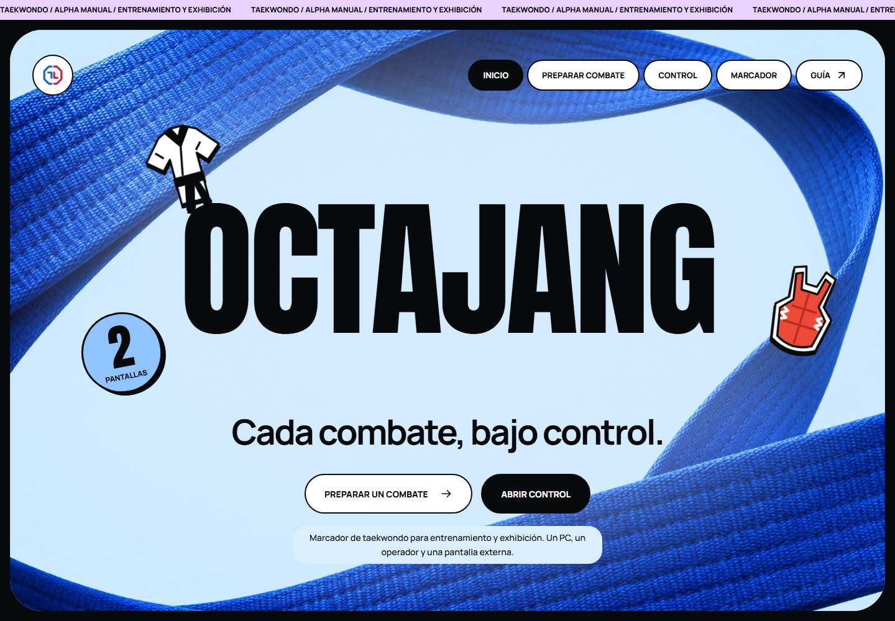

<div align="center">


# Octajang

**English** · [Español](docs/es/README.md) · [Italiano](docs/it/README.md)

**Every match, under control.**

A manual Taekwondo scoreboard for training and exhibitions. One PC, one operator, a second screen.

[](docs/releases/v1.0.0.md) [](https://github.com/karatekah/octajang/actions/workflows/ci.yml) [](LICENSE) [](https://octajang.vercel.app)

[Try Free](https://octajang.vercel.app) · [User guide](https://octajang.vercel.app/guia) · [Documentation](#documentation) · [Roadmap](docs/roadmap.md) · [Report a bug](https://github.com/karatekah/octajang/issues)

</div>

---

Prepare the athletes, run the clock and record each decision. **Free 1.0** keeps scores across rounds and synchronizes a read-only scoreboard with another window in the same browser.

**Free 1.0 is in preparation. The proposed scoreboard redesign and final release still require approval. After that release, its feature set stays fixed and new development continues in Pro.** [Free 1.0](docs/free-1.0.md).

## What you can use today

- **Free match setup.** Event, two athletes, country selection and automatic flags, 1 or 3 rounds and fixed 1-, 2- or 3-minute durations.
- **Manual scoring.** Add 1, 2, 3, 4 or 6 points or correct with −1 without going below zero; Gam-jeom adds a penalty and a point to the opponent.
- **Final result.** The last round ends with a winner by accumulated points or a draw. Confirm a manual KO to declare the selected athlete the winner, stop the clock and close scoring. Both screens and summaries show the result; undo can correct a mistaken KO.
- **Operator control.** Start, pause, technical timeout, next round, swap sides and undo the latest available action.
- **Second-screen scoreboard.** Open a read-only window, move it to another monitor and use fullscreen. A browser lock keeps a single operator in control.
- **Local records.** Keep match summaries and export or restore a validated JSON backup.

<div align="center">



<sub>Preview of the public training alpha. The application interface is currently in Spanish.</sub>

</div>

## Try a match

1. [Open the demo](https://octajang.vercel.app) in an up-to-date Chrome, Edge or Firefox.
2. Select **Preparar combate**, enter the athletes and format, then save.
3. In **Control**, select **Abrir pantalla externa** and move that window to the second monitor.
4. Start the clock and record points. Open **Gestión del combate** to save a summary, then export JSON from **Preparar combate**.

Both windows must share the **same PC, site origin, browser and profile**. Keep the control tab open; reloading it pauses the clock. Another device or a private browsing session has independent data.

Free 1.0 is for training and exhibitions. It does not connect electronic protectors, enforce an official WT ruleset or hold sporting certification.

## Architecture and stack

| Component           | Implemented in Free 1.0                                                         |
| ------------------- | ------------------------------------------------------------------------------- |
| Application         | TypeScript 7.0.2, strict types and ES modules                                   |
| Interface           | Semantic HTML, CSS tokens and locally hosted Anton / Manrope / Barlow Condensed |
| Build               | Vite 8.3.5; Node 24.22.1 LTS and npm 11 for development                         |
| Match state         | Separate domain logic and an elapsed monotonic clock                            |
| Storage             | Versioned localStorage and validated JSON import/export                         |
| Window coordination | Web Locks, BroadcastChannel and storage events                                  |
| Verification        | Vitest, Playwright, axe and Prettier                                            |
| Delivery            | GitHub Actions and the existing Vercel project                                  |

Direct dependencies and their resolution are pinned in package.json and package-lock.json. [Architecture](docs/architecture.md) describes the current runtime; [ADR 0001](docs/adr/0001-foundation.md) records its foundation.

### Planned tournament architecture

The next product is designed for **multiple areas, judges and displays on a venue LAN, without Internet**. Judges propose points; the area's desk confirms them, and a local server owns the clock and results.

The selected target stack is React / TypeScript / Vite, React Router, TanStack Query, a modular Go server, local SQLite, HTTPS and WebSocket. **This migration is not implemented in Free 1.0.** [Stack decisions](docs/stack.md), [ADR 0002](docs/adr/0002-tournament-lan.md) and the [migration plan](docs/migration.md) explain the choices and acceptance criteria. Sensors come in a later phase.

## Records and limits

- Up to **120 actions per match** and **10 new saved summaries** in Free. Old actions expire first; summaries require explicit deletion after exporting JSON to make room.
- Older supported backups retain custom formats, impact counts and up to 80 summaries. Free presets apply to new matches; importing does not trim previous records.
- JSON imports accept the supported backup format, up to **5 MB**, and require confirmation before replacing current data.
- New backups use **v5** to preserve KO decisions. Existing v4 backups remain readable; v5 requires the current version or later to restore.
- Compatible v2/v3 match state and summaries are recovered; their detailed action history and undo snapshots are not migrated. Original storage keys remain.
- Match data belongs to the current browser profile. Export a backup before clearing site data, switching profiles or changing domains; there is no cloud backup.

## Documentation

| Need                            | Guide                                                                                                                                             |
| ------------------------------- | ------------------------------------------------------------------------------------------------------------------------------------------------- |
| Use the scoreboard              | [Public user guide](https://octajang.vercel.app/guia) · [Free 1.0 scope](docs/free-1.0.md)                                                        |
| Understand the code             | [Current architecture](docs/architecture.md) · [Foundation decision](docs/adr/0001-foundation.md)                                                 |
| Review the tournament direction | [Target stack](docs/stack.md) · [LAN architecture](docs/tournament-architecture.md) · [Migration](docs/migration.md) · [Roadmap](docs/roadmap.md) |
| Inspect quality and design      | [Verification matrix](docs/verification.md) · [Interface review](docs/interface-review.md) · [Visual identity and assets](docs/branding.md)       |
| Run or publish changes          | [Contributing](CONTRIBUTING.md) · [Vercel deployment](docs/deployment.md)                                                                         |
| Review releases and security    | [Free 1.0 notes](docs/releases/v1.0.0.md) · [Changelog](CHANGELOG.md) · [Security](SECURITY.md)                                                   |

This overview is available in English, Spanish and Italian. The application and linked technical guides are currently in Spanish.

## Development

Use Node 24.22.1 and npm 11:

```sh
npm ci
npm run dev
```

<details>
<summary>Build and verify</summary>

```sh
npm run check
npm run build
npx playwright install chromium firefox
npm run test:e2e
npm run preview
```

The production build goes to dist/. Serve it over HTTP; opening the HTML through file:// is not supported. Linux CI installs browser dependencies with `npx playwright install --with-deps chromium firefox`.

The [verification matrix](docs/verification.md) separates automated coverage from pending physical tests. A real PC with two monitors, viewing distance and screen-reader testing still need field validation.

</details>

---

Code is licensed under [GNU GPL v3](LICENSE). Local font licenses are preserved in [public/fonts](public/fonts). See [visual identity and graphic assets](docs/design-preview.md).

[Made by Karatekah](https://github.com/karatekah)
