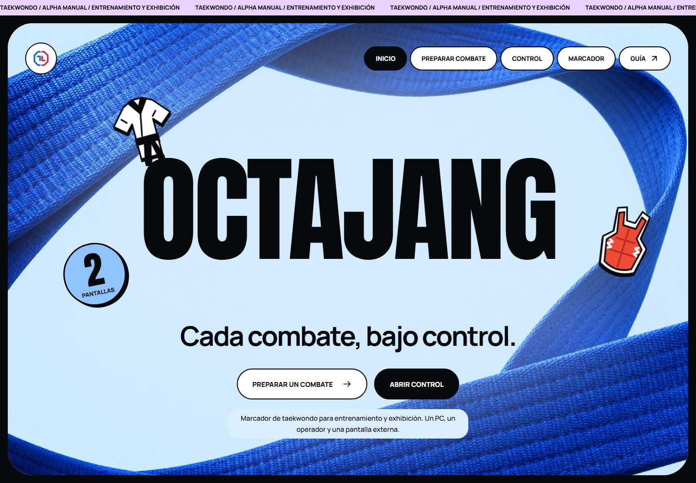

<div align="center">


# Octajang

[English](../../README.md) · **Español** · [Italiano](../it/README.md)

**Cada combate, bajo control.**

Un marcador manual de Taekwondo para entrenamiento y exhibición. Un PC, un operador y una segunda pantalla.

[](https://github.com/karatekah/octajang/releases/tag/v0.1.0-alpha.1) [](https://github.com/karatekah/octajang/actions/workflows/ci.yml) [](../../LICENSE) [](https://octajang.vercel.app)

[Probar la alpha](https://octajang.vercel.app) · [Guía de uso](https://octajang.vercel.app/guide.html) · [Documentación](#documentación) · [Roadmap](../roadmap.md) · [Reportar un problema](https://github.com/karatekah/octajang/issues)

</div>

---

Prepara los atletas, controla el reloj y registra cada decisión. La **alpha web experimental** acumula puntos entre rondas y sincroniza un marcador de solo lectura con otra ventana del mismo navegador.

## Qué puedes usar hoy

- **Configuración Free.** Evento, dos atletas, códigos de país, 1 o 3 rondas y tiempos fijos de 1, 2 o 3 minutos.
- **Puntuación manual.** Suma de 1 a 6 puntos o corrección −1 sin bajar de cero; Gam-jeom añade una penalización y un punto al rival.
- **Resultado final.** Ganador por puntos acumulados o empate al terminar la última ronda. Un KO manual, tras confirmar, declara ganador al atleta seleccionado, detiene el reloj y cierra la puntuación. Ambas pantallas y los resúmenes muestran el resultado; Deshacer permite corregir un KO marcado por error.
- **Control del operador.** Inicio, pausa, tiempo técnico, siguiente ronda, intercambio de lados y deshacer la última acción disponible.
- **Marcador en segunda pantalla.** Abre una ventana de solo lectura, muévela al otro monitor y activa pantalla completa. Un bloqueo del navegador mantiene un único operador.
- **Registros locales.** Guarda resúmenes y exporta o restaura una copia JSON validada.

<div align="center">



<sub>Vista previa de la alpha pública de entrenamiento. La interfaz está en español.</sub>

</div>

## Probar un combate

1. [Abre la demo](https://octajang.vercel.app) en Chrome, Edge o Firefox actualizado.
2. Selecciona **Preparar combate**, introduce atletas y formato, y guarda.
3. En **Control**, selecciona **Abrir pantalla externa** y mueve esa ventana al segundo monitor.
4. Inicia el reloj y registra puntos. Abre **Gestión del combate** para guardar un resumen y exporta JSON desde **Preparar combate**.

Ambas ventanas deben compartir **PC, origen del sitio, navegador y perfil**. Mantén abierta la pestaña de control; recargarla pausa el reloj. Otro dispositivo o una sesión privada mantiene datos independientes.

Esta alpha es para entrenamiento y exhibición. No conecta protectores electrónicos ni aplica un reglamento WT oficial; tampoco cuenta con homologación deportiva.

## Arquitectura y stack

| Componente               | Implementado en la alpha                                                            |
| ------------------------ | ----------------------------------------------------------------------------------- |
| Aplicación               | TypeScript 7.0.2, tipos estrictos y módulos ES                                      |
| Interfaz                 | HTML semántico, tokens CSS y Anton / Manrope / Barlow Condensed alojadas localmente |
| Compilación              | Vite 8.3.5; Node 24.22.1 LTS y npm 11 para desarrollo                               |
| Estado del combate       | Dominio separado y reloj monotónico por tiempo transcurrido                         |
| Almacenamiento           | localStorage versionado e importación/exportación JSON validada                     |
| Coordinación de ventanas | Web Locks, BroadcastChannel y eventos de almacenamiento                             |
| Verificación             | Vitest, Playwright, axe y Prettier                                                  |
| Distribución             | GitHub Actions y el proyecto existente de Vercel                                    |

Las dependencias directas y su resolución están fijadas en package.json y package-lock.json. [Arquitectura](../architecture.md) describe el runtime actual; [ADR 0001](../adr/0001-foundation.md) registra su base.

### Arquitectura de torneos planificada

El siguiente producto está diseñado para **varias áreas, jueces y pantallas en la LAN del recinto, sin Internet**. Los jueces proponen puntos, la mesa del área los confirma y un servidor local mantiene el reloj y los resultados.

El stack objetivo es React / TypeScript / Vite, React Router, TanStack Query, un servidor Go modular, SQLite local, HTTPS y WebSocket. **Esta migración todavía no está implementada en la alpha 0.1.** Las [decisiones de stack](../stack.md), [ADR 0002](../adr/0002-tournament-lan.md) y el [plan de migración](../migration.md) explican las elecciones y los criterios de aceptación. Los sensores corresponden a una fase posterior.

## Registros y límites

- Hasta **120 acciones por combate** y **10 resúmenes nuevos** en Free. Las acciones antiguas se retiran primero; los resúmenes se eliminan explícitamente, después de exportar JSON, para liberar espacio.
- Los respaldos anteriores compatibles conservan formatos personalizados, impactos y hasta 80 resúmenes. Los presets de Free se aplican a combates nuevos; importar no recorta los registros anteriores.
- La importación JSON admite el formato soportado por la alpha, hasta **5 MB**, y pide confirmar antes de reemplazar los datos.
- Las copias nuevas usan **v5** para conservar los KO. Las copias v4 siguen siendo recuperables; para restaurar v5 se necesita esta versión o una posterior.
- Se recuperan el combate y los resúmenes compatibles v2/v3; su registro detallado y los snapshots para deshacer no se migran. Las claves de almacenamiento originales se conservan.
- Los datos pertenecen al perfil actual del navegador. Exporta una copia antes de borrar datos del sitio, cambiar de perfil o de dominio; no hay respaldo en la nube.

## Documentación

| Necesidad                       | Guía                                                                                                                                        |
| ------------------------------- | ------------------------------------------------------------------------------------------------------------------------------------------- |
| Usar el marcador                | [Guía pública](https://octajang.vercel.app/guide.html) · [Alcance de la alpha](../alpha.md)                                                 |
| Entender el código              | [Arquitectura actual](../architecture.md) · [Decisión inicial](../adr/0001-foundation.md)                                                   |
| Revisar la dirección de torneos | [Stack objetivo](../stack.md) · [Arquitectura LAN](../tournament-architecture.md) · [Migración](../migration.md) · [Roadmap](../roadmap.md) |
| Revisar calidad y diseño        | [Verificación](../verification.md) · [Revisión de interfaz](../interface-review.md) · [Identidad visual y recursos](../branding.md)         |
| Ejecutar o publicar cambios     | [Contribuir](../../CONTRIBUTING.md) · [Despliegue Vercel](../deployment.md)                                                                 |
| Revisar versiones y seguridad   | [Notas de la alpha](../releases/v0.1.0-alpha.1.md) · [Changelog](../../CHANGELOG.md) · [Seguridad](../../SECURITY.md)                       |

Esta presentación está disponible en inglés, español e italiano. La aplicación y las guías técnicas enlazadas están actualmente en español.

## Desarrollo

Usa Node 24.22.1 y npm 11:

```sh
npm ci
npm run dev
```

<details>
<summary>Compilar y verificar</summary>

```sh
npm run check
npm run build
npx playwright install chromium firefox
npm run test:e2e
npm run preview
```

El build de producción se genera en dist/. Sírvelo por HTTP; abrir el HTML mediante file:// no está soportado. CI en Linux instala dependencias de navegador con `npx playwright install --with-deps chromium firefox`.

La [matriz de verificación](../verification.md) distingue pruebas automatizadas y físicas pendientes. Queda por validar un PC real con dos monitores, legibilidad a distancia y lectores de pantalla.

</details>

---

El código utiliza [GNU GPL v3](../../LICENSE). Las licencias de las fuentes locales se conservan en [public/fonts](../../public/fonts). Consulta la [identidad visual y los recursos gráficos](../design-preview.md).
