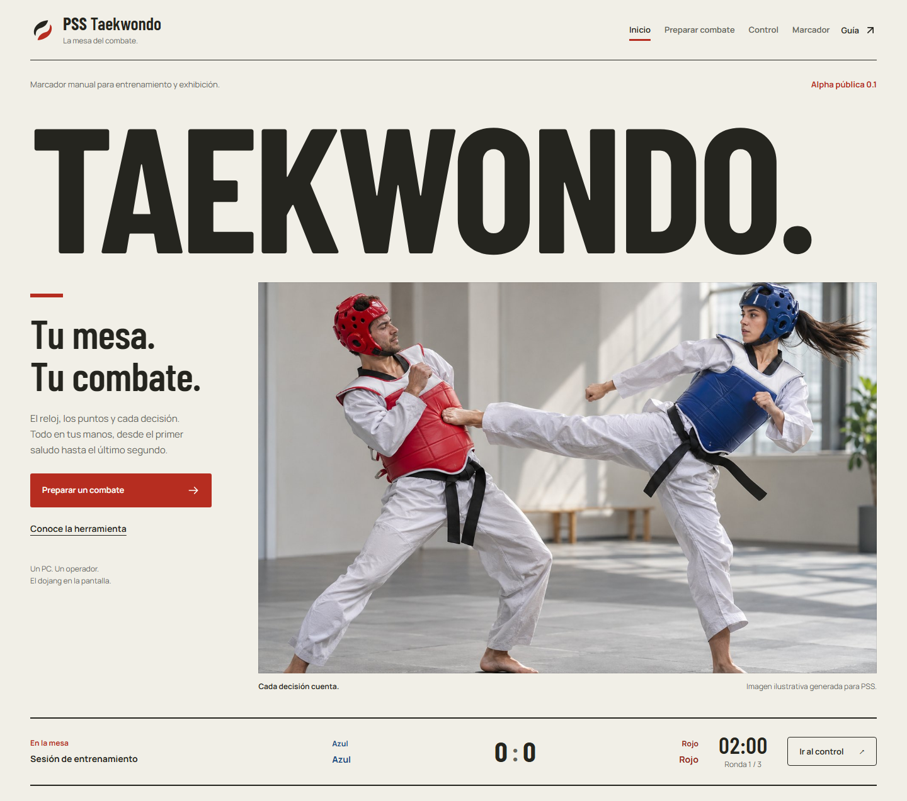

<div align="center">


# PSS Taekwondo

[English](../../README.md) · [Español](../es/README.md) · **Italiano**

**Ogni punto conta.**

Un tabellone manuale di Taekwondo per allenamenti ed esibizioni. Un PC, un operatore, un secondo schermo.

[](https://github.com/karatekah/Protector-and-Scoring-System-PSS-Taekwondo/releases/tag/v0.1.0-alpha.1) [](https://github.com/karatekah/Protector-and-Scoring-System-PSS-Taekwondo/actions/workflows/ci.yml) [](../../LICENSE) [](https://protector-and-scoring-system-pss-tkdrolando.vercel.app)

[Prova l'alpha](https://protector-and-scoring-system-pss-tkdrolando.vercel.app) · [Guida all'uso](https://protector-and-scoring-system-pss-tkdrolando.vercel.app/guide.html) · [Documentazione](#documentazione) · [Roadmap](../roadmap.md) · [Segnala un problema](https://github.com/karatekah/Protector-and-Scoring-System-PSS-Taekwondo/issues)

</div>

---

Prepara gli atleti, gestisci il cronometro e registra ogni decisione. L'**alpha web sperimentale** accumula i punti tra le riprese e sincronizza un tabellone in sola lettura con un'altra finestra dello stesso browser.

## Funzioni disponibili

- **Configurazione dell'incontro.** Evento, due atleti, codici paese, 1–5 riprese e durata da 00:10 a 09:59 per ripresa.
- **Punteggio manuale.** Aggiungi da 1 a 6 punti; Gam-jeom registra una penalità e assegna un punto all'avversario. Registra gli impatti senza assegnare punti.
- **Controllo dell'operatore.** Avvio, pausa, timeout tecnico, ripresa successiva, scambio dei lati e annullamento dell'ultima azione disponibile.
- **Tabellone sul secondo schermo.** Apri una finestra in sola lettura, spostala sull'altro monitor e attiva lo schermo intero. Un blocco del browser mantiene un solo operatore al controllo.
- **Registri locali.** Salva i riepiloghi ed esporta o ripristina una copia JSON convalidata.

<div align="center">



<sub>Anteprima dell'alpha pubblica per allenamenti. L'interfaccia dell'applicazione è attualmente in spagnolo.</sub>

</div>

## Prova un incontro

1. [Apri la demo](https://protector-and-scoring-system-pss-tkdrolando.vercel.app) con Chrome, Edge o Firefox aggiornato.
2. Seleziona **Preparar combate**, inserisci gli atleti e il formato, quindi salva.
3. In **Control**, seleziona **Abrir pantalla externa** e sposta la finestra sul secondo monitor.
4. Avvia il cronometro e registra i punti. Apri **Gestión del combate** per salvare un riepilogo, poi esporta JSON da **Preparar combate**.

Le due finestre devono condividere **PC, origine del sito, browser e profilo**. Mantieni aperta la scheda di controllo; ricaricarla mette in pausa il cronometro. Un altro dispositivo o una sessione privata mantiene dati indipendenti.

Questa alpha è destinata ad allenamenti ed esibizioni. Non collega protezioni elettroniche, non applica un regolamento WT ufficiale e non dispone di omologazione sportiva. Il nome storico del repository esprime la direzione più ampia del progetto.

## Architettura e stack

| Componente                   | Implementato nell'alpha                                                     |
| ---------------------------- | --------------------------------------------------------------------------- |
| Applicazione                 | TypeScript 7.0.2, tipi rigorosi e moduli ES                                 |
| Interfaccia                  | HTML semantico, token CSS e Manrope / Barlow Condensed ospitati localmente  |
| Build                        | Vite 8.3.5; Node 24.22.1 LTS e npm 11 per lo sviluppo                       |
| Stato dell'incontro          | Dominio separato e cronometro basato sul tempo monotono trascorso           |
| Archiviazione                | localStorage con versionamento e importazione/esportazione JSON convalidata |
| Coordinamento delle finestre | Web Locks, BroadcastChannel ed eventi di archiviazione                      |
| Verifica                     | Vitest, Playwright, axe e Prettier                                          |
| Distribuzione                | GitHub Actions e il progetto Vercel esistente                               |

Le dipendenze dirette e la loro risoluzione sono fissate in package.json e package-lock.json. [Architettura](../architecture.md) descrive il runtime attuale; [ADR 0001](../adr/0001-foundation.md) ne documenta le basi.

### Architettura dei tornei pianificata

Il prodotto successivo è progettato per **più aree, giudici e schermi sulla LAN della sede, senza Internet**. I giudici propongono i punti, il tavolo dell'area li conferma e un server locale gestisce il cronometro e i risultati.

Lo stack scelto comprende React / TypeScript / Vite, React Router, TanStack Query, un server Go modulare, SQLite locale, HTTPS e WebSocket. **Questa migrazione non è ancora implementata nell'alpha 0.1.** Le [decisioni sullo stack](../stack.md), [ADR 0002](../adr/0002-tournament-lan.md) e il [piano di migrazione](../migration.md) spiegano le scelte e i criteri di accettazione. I sensori appartengono a una fase successiva.

## Registri e limiti

- Fino a **120 azioni per incontro** e **80 riepiloghi salvati**; vengono rimossi prima i dati più vecchi.
- L'importazione JSON accetta il formato supportato dall'alpha, fino a **5 MB**, e richiede conferma prima di sostituire i dati.
- Vengono recuperati lo stato dell'incontro e i riepiloghi v2/v3 compatibili; la cronologia dettagliata e gli snapshot per l'annullamento non vengono migrati. Le chiavi di archiviazione originali rimangono.
- I dati appartengono al profilo corrente del browser. Esporta una copia prima di cancellare i dati del sito, cambiare profilo o dominio; non è disponibile un backup nel cloud.

## Documentazione

| Esigenza                          | Guida                                                                                                                                         |
| --------------------------------- | --------------------------------------------------------------------------------------------------------------------------------------------- |
| Usare il tabellone                | [Guida pubblica](https://protector-and-scoring-system-pss-tkdrolando.vercel.app/guide.html) · [Ambito dell'alpha](../alpha.md)                |
| Comprendere il codice             | [Architettura attuale](../architecture.md) · [Decisione iniziale](../adr/0001-foundation.md)                                                  |
| Esaminare la direzione dei tornei | [Stack obiettivo](../stack.md) · [Architettura LAN](../tournament-architecture.md) · [Migrazione](../migration.md) · [Roadmap](../roadmap.md) |
| Verificare qualità e design       | [Matrice di verifica](../verification.md) · [Revisione dell'interfaccia](../interface-review.md) · [Identità visiva e risorse](../design.md)  |
| Eseguire o pubblicare modifiche   | [Contribuire](../../CONTRIBUTING.md) · [Deployment Vercel](../deployment.md)                                                                  |
| Consultare versioni e sicurezza   | [Note dell'alpha](../releases/v0.1.0-alpha.1.md) · [Changelog](../../CHANGELOG.md) · [Sicurezza](../../SECURITY.md)                           |

Questa presentazione è disponibile in inglese, spagnolo e italiano. L'applicazione e le guide tecniche collegate sono attualmente in spagnolo.

## Sviluppo

Usa Node 24.22.1 e npm 11:

```sh
npm ci
npm run dev
```

<details>
<summary>Compilare e verificare</summary>

```sh
npm run check
npm run build
npx playwright install chromium firefox
npm run test:e2e
npm run preview
```

La build di produzione viene generata in dist/. Servila via HTTP; aprire l'HTML tramite file:// non è supportato. La CI su Linux installa le dipendenze del browser con `npx playwright install --with-deps chromium firefox`.

La [matrice di verifica](../verification.md) distingue la copertura automatizzata dalle prove fisiche ancora necessarie: un PC reale con due monitor, leggibilità a distanza e lettori di schermo.

</details>

---

Il codice usa [GNU GPL v3](../../LICENSE). Le licenze dei font locali sono conservate in [public/fonts](../../public/fonts); l'origine dell'illustrazione generata e del marchio originale è documentata nell'[identità visiva](../design.md).
