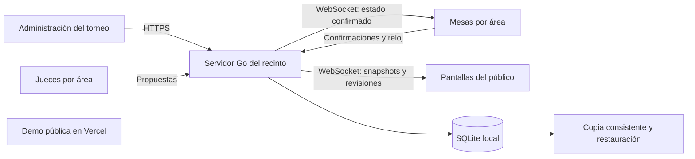

# Stack objetivo de Octajang

La evolución funcional descrita en este documento corresponde a Pro. Free 1.0 mantiene su [alcance cerrado](free-1.0.md).

Estado: definido como dirección técnica; la implementación LAN está pendiente.

Esta reformulación amplía el producto más allá de la alpha de entrenamiento. Conserva su demo pública y establece una arquitectura para torneos que funcione dentro del recinto sin Internet.

## Requisitos confirmados

1. Software de torneos con varias áreas, jueces y pantallas.
2. El evento funciona por red local aunque falle Internet.
3. Los jueces envían propuestas; la mesa confirma los puntos.
4. Los sensores se investigarán después, con protocolo y hardware reales.
5. Vercel conserva la demo web. El ZIP local sigue pospuesto en la entrega actual.

## Stack por responsabilidad

| Responsabilidad         | Tecnología elegida                                                                        | Motivo                                                                                                                     | Incorporación              |
| ----------------------- | ----------------------------------------------------------------------------------------- | -------------------------------------------------------------------------------------------------------------------------- | -------------------------- |
| Interfaz                | React + TypeScript estricto + Vite                                                        | Componentes compartidos para administración, mesa, juez y marcador; build estático reutilizable                            | Migración de frontend      |
| Navegación              | React Router en modo declarativo                                                          | Rutas por evento, área, combate y rol; enlaces directos y navegación de navegador                                          | Migración de frontend      |
| Diseño                  | CSS con tokens y CSS Modules para componentes                                             | Conservar el lenguaje visual y limitar estilos al componente                                                               | Migración de frontend      |
| Datos de administración | TanStack Query                                                                            | Carga, errores y caché de datos que pertenecen al servidor                                                                 | Integración de API         |
| Marcador en vivo        | Suscripción a snapshots versionados mediante WebSocket y estado de React                  | Evitar que la caché HTTP o los controles de un juez se conviertan en autoridad                                             | Integración LAN            |
| Servidor                | Go, monolito modular, HTTP de la biblioteca estándar                                      | Un servicio local que pueda servir frontend, API y eventos; compilación nativa y continuidad con la experiencia de KARATTY | Servidor del recinto       |
| API                     | REST/JSON sobre HTTPS, descrita con OpenAPI                                               | Contratos explícitos y tipos de cliente generados mediante openapi-typescript                                              | Servidor del recinto       |
| Eventos                 | WebSocket sobre TLS, con biblioteca Go mantenida seleccionada al integrar                 | Propuestas, confirmaciones, cambios de reloj y snapshots por área                                                          | Servidor del recinto       |
| Persistencia            | SQLite en el disco local del servidor                                                     | Base transaccional integrada, sin instalar un servicio de base de datos adicional                                          | Servidor del recinto       |
| Acceso SQL              | database/sql + modernc.org/sqlite, consultas parametrizadas y migraciones SQL versionadas | Driver Go sin CGO; consultas y transacciones explícitas                                                                    | Persistencia               |
| Sesiones                | Sesiones locales revocables, emparejamiento temporal y permisos por evento/área           | Funciona sin proveedor de identidad externo y limita lo que puede hacer cada dispositivo                                   | Integración LAN            |
| Respaldo                | Copia consistente de SQLite, manifiesto de versión y comprobación de restauración         | Recuperar el evento completo, incluyendo comandos y decisiones                                                             | Persistencia               |
| Calidad frontend        | TypeScript, ESLint, Prettier, Vitest, React Testing Library, Playwright y axe             | Tipos, reglas de React, comportamiento, accesibilidad y flujos de varios dispositivos                                      | Por fase de migración      |
| Calidad servidor        | gofmt, go vet, go test, detector de carreras y govulncheck                                | Dominio, almacenamiento, concurrencia y dependencias                                                                       | Servidor del recinto       |
| Automatización          | GitHub Actions y lockfiles                                                                | Verificaciones repetibles y generación verificable de contratos                                                            | En cada fase               |
| Operación local         | Binario Go que sirve el build de React, configuración y datos fuera del ejecutable        | Los dispositivos necesitan navegador y conexión al servidor del recinto                                                    | Distribución LAN posterior |
| Demo pública            | Proyecto existente de Vercel                                                              | Mantener un acceso sencillo a la demo de entrenamiento                                                                     | Ya disponible              |

La tabla describe el objetivo, no dependencias ya instaladas. Las versiones reales de la alpha están en package.json/package-lock.json. Cada nueva dependencia se fijará, comprobará y licenciará en el commit que la incorpore. El futuro servidor tendrá go.mod/go.sum. No se crean manifiestos ni directorios vacíos para aparentar una migración terminada.

## Operación y mantenimiento

El servidor registrará eventos estructurados con log/slog, identificadores de comando y tiempos de procesamiento. Los logs no incluirán credenciales ni datos personales innecesarios. La salud del proceso, versión del esquema, última copia válida y estado de las conexiones serán visibles para administración.

La instalación deberá verificar disco, permisos de datos, dirección local y confianza de certificados antes de abrir un torneo. La actualización se hará entre sesiones, con copia previa y procedimiento de recuperación. Docker no será un requisito para el operador; los recursos del frontend irán en el servidor local.

Redis, colas externas, microservicios y Kubernetes quedan fuera del diseño inicial. Se incorporaría otro componente de infraestructura ante una necesidad medida y una decisión nueva, con su coste de operación y su prueba de recuperación.

## Qué distingue este diseño de la alpha actual

| Aspecto      | Alpha 0.1 publicada                  | Producto objetivo                                      |
| ------------ | ------------------------------------ | ------------------------------------------------------ |
| Pantallas    | Ventanas del mismo navegador         | Dispositivos de la red local                           |
| Autoridad    | Una pestaña de control con Web Lock  | Servidor del recinto                                   |
| Datos        | localStorage y respaldo JSON         | SQLite del evento y copias consistentes                |
| Puntuación   | La mesa registra puntos directamente | Jueces proponen y la mesa confirma                     |
| Interfaz     | HTML y TypeScript con DOM nativo     | React con vistas y componentes por rol                 |
| Reglas       | Entrenamiento con puntos acumulados  | Perfil de reglas identificado y decisiones registradas |
| Recuperación | Último estado local guardado         | Revisión, comandos confirmados y reanudación explícita |

## Decisiones frente a alternativas

**React + Vite.** Las vistas de torneos añaden componentes compartidos, rutas, formularios y suscripciones. Se conserva Vite y la lógica verificable existente. Se elige React por ese alcance ampliado. Next.js no aporta una necesidad de renderizado en servidor para la mesa o el juez; se reconsideraría para un portal público distinto si aparece esa necesidad.

**Go frente a Node/TypeScript para el servidor.** Go permite mantener un único proceso local y una distribución nativa, y continúa patrones ya trabajados en KARATTY. El coste es mantener contratos entre dos lenguajes; OpenAPI y los casos compartidos de prueba reducen divergencias. Node con un framework mantenido sería una alternativa válida si la prioridad cambiara a compartir todo el dominio TypeScript.

**SQLite frente a PostgreSQL.** El servidor es el único proceso que abre la base. Los jueces y pantallas acceden por la API. Esto permite elegir SQLite para el evento local y simplifica la preparación del recinto. SQLite admite un único escritor simultáneo; las transacciones deben ser breves y la carga debe medirse. Se reconsiderará PostgreSQL si aparecen varios servidores escritores, un servicio central de varios eventos o contención de escritura medida. La experiencia de KARATTY con PostgreSQL sigue siendo útil para transacciones y migraciones.

**Estado de React frente a otra librería global.** El marcador proyecta snapshots autorizados del servidor; los formularios conservan estado local. TanStack Query gestiona los datos HTTP. Una segunda librería global se añadirá solo ante un problema concreto que esos mecanismos no resuelvan.

**Vercel y el recinto.** La demo pública sigue en Vercel. La versión de torneo sirve interfaz, API y WebSocket desde el servidor local y el mismo origen. El corte de Internet no forma parte del camino de puntuación. Tampoco se dependerá de fuentes, scripts, autenticación o CDN externos durante el evento.

## Arquitectura de destino

El diagrama representa el diseño objetivo. La demo de Vercel es independiente del servidor del evento; compartir su enlace no conecta a un torneo LAN.

## Límites y pruebas que condicionan la elección

Se usará inicialmente un presupuesto de validación de cuatro áreas, tres jueces, una mesa y una pantalla por área, más administración: 21 sesiones simultáneas. Es una hipótesis de prueba, no una capacidad certificada ni una cantidad de jueces impuesta por reglamento.

Antes de anunciar ese soporte se debe medir latencia de propuesta/confirmación, estabilidad del reloj y contención de escritura bajo esa carga, y repetir con dispositivos físicos. El protocolo y la separación por área se diseñan desde el inicio; no se promete un número ilimitado de áreas.

Las copias, restauración, revocación, duplicados, desconexiones y caída del proceso son parte de la aceptación, junto con la accesibilidad. El desarrollo posterior deberá elegir el reglamento deportivo y la configuración real del primer evento antes de producir resultados oficiales.

## Referencias primarias

- [React con un build tool](https://react.dev/learn/build-a-react-app-from-scratch).
- [React Router](https://reactrouter.com/start/declarative/installation).
- [TanStack Query](https://tanstack.com/query/latest/docs/framework/react/overview).
- [Transacciones en Go](https://go.dev/doc/database/execute-transactions).
- [Usos de SQLite](https://sqlite.org/whentouse.html) y [WAL](https://sqlite.org/wal.html).
- [Driver modernc.org/sqlite](https://pkg.go.dev/modernc.org/sqlite).
- [Respaldo consistente de SQLite](https://sqlite.org/backup.html).

La recomendación de arquitectura es una decisión del proyecto basada en los requisitos confirmados; las fuentes describen las capacidades y límites de las tecnologías, no certifican Octajang.
